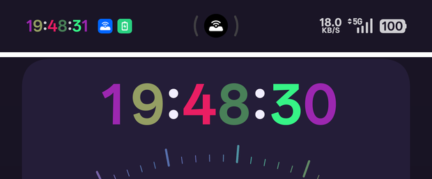
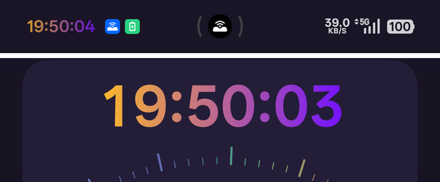

<div align="center">

[简体中文](../README.md) · [English](README_EN.md) · [繁體中文](README_zh-TW.md) · [日本語](README_ja.md) · [한국어](README_ko.md) · [Türkçe](README_tr.md) · [Русский](README_ru.md) · [Tiếng Việt](README_vi.md) · [ไทย](README_th.md) · **Deutsch** · [Español](README_es.md) · [Français](README_fr.md) · [Українська](README_uk.md) · [Polski](README_pl.md) · [Português (Brasil)](README_pt-BR.md) · [فارسی](README_fa.md) · [العربية](README_ar.md) · [Bahasa Indonesia](README_id.md) · [Italiano](README_it.md) · [Ελληνικά](README_el.md) · [ქართული](README_ka.md)

</div>

<div align="center">

# Sekunden in der Statusleiste (Show Seconds in Time)

Zeigt **Sekunden** in der Uhr der Statusleiste, umschaltbar per Tippen. Entweder **jede Ziffer eigene Farbe** oder ein **Farbverlauf** über den ganzen Text.<br>**Langes Drücken** öffnet ein Milchglas-Fenster mit **Netzwerkzeit** (verschieben, Größe, Verlauf); **eigene Aufgaben** schalten Sekunden zur passenden Stunde ein.<br>Der Hauptpfad nutzt nur öffentliche AOSP-APIs (proprietäre OPPO / OnePlus / realme-Klassen sind optional, fehlen sie, werden sie übersprungen). Getestet auf ColorOS 15 / 16.

[](https://github.com/kelebao/ClockSeconds/releases/latest)

[](https://github.com/Xposed-Modules-Repo/io.github.kelebao.colorosclockseconds/releases)

[](https://github.com/kelebao/ClockSeconds/stargazers)
[](https://github.com/kelebao/ClockSeconds/blob/main/LICENSE)

</div>

---

## Funktionen

| Funktion | Details |
|------|------|
| Sekunden in der Statusleiste | `HH:mm:ss` / `h:mm:ss a`, folgt 12/24-Stunden-Format und Zeitzone. Am Ende steht ein **Leerzeichen der Breite null**, damit Themes die Farben nicht verlieren, bei Farbverlust wird automatisch neu gezeichnet (5 Minuten Pause). |
| Tippen zum Umschalten | **Tippen** schaltet die Sekunden (wahlweise **Doppeltippen**), **langes Drücken** gehört dem Vorschaufenster. Innerhalb einer Aufgabe wird „von Aufgabe gesteuert" gemeldet. |
| Farbe je Ziffer / Verlauf | Sechs Ziffern **jede in eigener Farbe** (10 Vorlagen + HSV-Regler + Systemfarbe), Doppelpunkte optisch zentriert. Oder ein **Verlauf** von Start- zu Endfarbe (6 Sätze, freie Enden, auf hellem Grund abgedunkelt). Die Vorschaukarte **zeichnet selbst** und stimmt pixelgenau mit der Statusleiste. |
| Vorschau per langem Drücken | Milchglas-Fenster mit **Netzwerkzeit**; verschieben, Größe an der Ecke ◣, Position und Größe **werden gemerkt**; Verlauf und Ziffern mit gleicher Breite. |
| Eigene Aufgaben | Fenster **jede Stunde** oder **jeden Tag**: Sekunden N Minuten vorher für M Minuten an, dann zurück. Zeitänderung oder Zeitzonenwechsel wird sofort neu berechnet, plus Sicherheitslauf alle 60 Sekunden. |
| Vergleich mit Netzwerkzeit | Zeigt die Abweichung zur **Netzwerkzeit**; ein Tippen auf **Synchronisieren** aktiviert die automatische Systemzeit. |
| Kein adb nötig | Konfiguration wird über `Settings.Secure` geschrieben; ohne `WRITE_SECURE_SETTINGS` übernimmt ein Broadcast an die SystemUI — **in keiner Funktion wird adb benötigt**. |
| Kachel im Schnellzugriff | Kachel „Sekunden anzeigen" hinzufügen, um ohne App zu schalten. |
| Ressourcenname der Uhr | Wird die Uhr nicht erkannt, **automatisch erkennen** tippen oder den Namen eintragen (z. B. `clock`). |
| 21 Oberflächensprachen | Folgt der Systemsprache: 简体中文, English, 繁體中文, 日本語, 한국어, Türkçe, Русский, Tiếng Việt, ไทย, Deutsch, Español, Français, Українська, Polski, Português (Brasil), فارسی, العربية, Bahasa Indonesia, Italiano, Ελληνικά, ქართული; alles andere Englisch. |
| Speicherung / Reichweite | Zustand liegt in `Settings.Secure`, prozessübergreifend und über Neustarts stabil. **Getestet auf ColorOS 15 / 16 (Android 15 / 16)**; der Kern nutzt nur öffentliche APIs, andere Hersteller sollten laufen, getestet sind aber nur OPPO / OnePlus. Ab Android 10. |

## Farbmodi

Zwei Arten der Färbung, umschaltbar in der Karte **Ziffernfarben**: **je Ziffer** oder **Verlauf** über den ganzen Text.

<table><tr>
<td align="center" width="50%">

<br>
Je Ziffer: jede Ziffer eigene Farbe, Doppelpunkte optisch zentriert
</td>
<td align="center" width="50%">

<br>
Verlauf: von Start- zu Endfarbe, 6 Sätze oder freie Enden
</td>
</tr></table>

## Installation

1. APK von der Seite [**Releases**](https://github.com/kelebao/ClockSeconds/releases/latest) laden
2. Modul in **LSPosed** aktivieren und den Bereich **System UI** (`com.android.systemui`) wählen
3. SystemUI-Prozess oder Gerät neu starten
4. Die Einstellungen öffnen sich über den **LSPosed-Manager** (kein App-Symbol im Launcher)

> Root (LSPosed) nötig. **adb-Rechte sind normalerweise nicht erforderlich**: geschrieben wird über `Settings.Secure`, ohne `WRITE_SECURE_SETTINGS` per Broadcast an die SystemUI. Soll die Einstellungsoberfläche **direkt** schreiben:
> ```bash
> adb shell pm grant io.github.kelebao.colorosclockseconds android.permission.WRITE_SECURE_SETTINGS
> ```
> Ohne Freigabe funktioniert alles trotzdem: Tippen, Aufgaben und Fenster laufen in der SystemUI.

## Bedienung

- **Auf die Uhr tippen**: Sekunden an/aus (Standard), in den Einstellungen auf **Doppeltippen** änderbar.
- **Lange drücken**: Milchglas-Fenster mit **Netzwerkzeit**, verschiebbar; Tippen zeigt **Schließen** (oben rechts) und **Größe** (unten links).
- Die Karte **Ziffernfarben** hat zwei Seiten, der Reiter selbst ist der Schalter.
- Die Karte **Eigene Aufgaben** plant Fenster wie „Sekunden 2 Minuten vor jeder Stunde an".
- Das Umschalten nutzt eine globale Tippprüfung und **kollidiert nicht mit dem Herunterziehen** des Schnellzugriffs.

## Vorschau

<table><tr>
<td align="center" width="50%">

<br>
Sekunden aus: `15:06`, Zehnerstunde behält die gewählte Farbe
</td>
<td align="center" width="50%">

<br>
Sekunden an: `15:06:03`, Minuten und Sekunden in Systemfarbe
</td>
</tr></table>

## So funktioniert es

Das Modul hookt ausschließlich die **SystemUI** und nutzt die stabile Legacy-Xposed-API.
**Der Kern nutzt nur öffentliche AOSP-APIs, herstellereigene Klassen sind optional und werden übersprungen, wenn sie fehlen** — daher kein Systemschaden und kein LSPosed-Sicherheitsmodus:

- **Sekunden**: `TextView.setText` (after) merkt den Systemtext, dann schreibt `TextView.onDraw` (before) `Original:ss`, Aktualisierung im Sekundentakt via `Handler`.
- **Farbe je Ziffer**: `ForegroundColorSpan` pro Zeichen (fremde Spans werden entfernt); die Doppelpunkte werden um 0.11em angehoben, weil mehrteilige Layouts die Glyphen tiefer setzen.
- **Verlauf**: `CharacterStyle` ruft `setShader` in `updateDrawState`; die Vorschau **zeichnet selbst** (`GradientTimeView`), weil ColorOS 15 Shader pro Textlauf quantisiert.
- **Umschalten**: das Panel fängt Tipps auf der Statusleiste ab, daher hookt das Modul global `View.dispatchTouchEvent` und schaltet nur bei Tipps im Uhrbereich ohne Ziehen; das Ereignis wird **nicht konsumiert**.
- **Aufgaben**: „liegt die lokale Zeit im Fenster", exakte Timer an den Rändern plus Sicherheitslauf alle 60 Sekunden.

## Akkuverbrauch

- **Sekunden an**: Timer pro Sekunde (unvermeidlich). Gemessen an der SystemUI pro Kern: 7.0% aus, 7.25% an (60 s).
- **Sekunden aus**: der Timer **stoppt sofort** (`stopTicker`), kein Aufwachen pro Sekunde.
- **Farbschutz** geht zurück 2s → 4s → … → 30s und endet nach 5 Minuten ohne Farbverlust.
- Zustand wird **im Prozess zwischengespeichert**; Aufgaben nutzen `Handler.postDelayed` — **kein WakeLock, kein AlarmManager**.

## Selbst bauen

Nötig sind **JDK 17+** (17 oder 21) und **Android SDK Platform 35** (AGP lädt Build-Tools 35 nach).

```bash
export JAVA_HOME=/path/to/jdk-17-or-21
./gradlew assembleDebug
```

## Sicherung und Weiterentwicklung (wichtig)

Im Ordner `ClockSeconds/` **alles außer `build/` und `.gradle/`** aufbewahren (Quellcode ~300 KB):

| Kategorie | Dateien | Hinweis |
|------|------|------|
| Build-Dateien | `settings.gradle.kts`, `build.gradle.kts`, `app/build.gradle.kts`, `gradle.properties`, `keystore.properties` | Versionen, Abhängigkeiten, Parameter, Signatur |
| Gradle Wrapper | `gradlew`, `gradlew.bat`, `gradle/wrapper/*` | Fixiert Gradle 8.14.5 |
| Quellcode | `app/src/main/java/**` (20 `.java`) | Modullogik, Einstellungen, Zeichenklassen |
| Ressourcen | `app/src/main/res/**` | Texte (22 Locales), Themes |
| Xposed-Metadaten | `app/src/main/resources/META-INF/xposed/*` | Einstiegsklasse, Bereich, API-Level |
| Manifest | `app/src/main/AndroidManifest.xml` | Berechtigungen, Activities |
| Werkzeuge | `tools/**` | README-Generator, i18n-Prüfung, Release-Skript |
| Dokumente | `README*.md`, `docs/**`, `CHANGELOG.md` | Beschreibung, Screenshots, Änderungsliste |
| CI | `.github/workflows/*.yml` | Signierter Build bei Tag |

## Fehlersuche

<details>
<summary>Schritte zeigen</summary>

Logcat ansehen:

- **Release-Builds** verbergen alle Diagnoseprotokolle hinter `BuildConfig.DEBUG`.
- Zum Debuggen einen **Debug-Build** installieren (`assembleDebug`, gleicher Schlüssel) und filtern:

  ```bash
  adb logcat -s ColorOSClockSeconds
  ```

- Keine Sekunden: Bereich „System UI" in LSPosed prüfen, neu starten, dann Schalter lesen/schreiben:

  ```bash
  adb shell settings get secure coloros_clock_seconds_enabled   # 1=an 0=aus
  adb shell settings put  secure coloros_clock_seconds_enabled 1
  ```

- Farben oder Sekunden kommen zurück: System oder Theme baut den Text neu, das Modul zeichnet nach; hilft das nicht, im Debug-Log nach `color-guard stopped` / `span-theft` suchen.

</details>

## Rückmeldung

Fragen und Vorschläge über [GitHub Issues](https://github.com/kelebao/ClockSeconds/issues).

## License

[MIT](LICENSE) © kelebao
