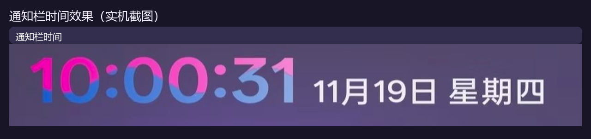
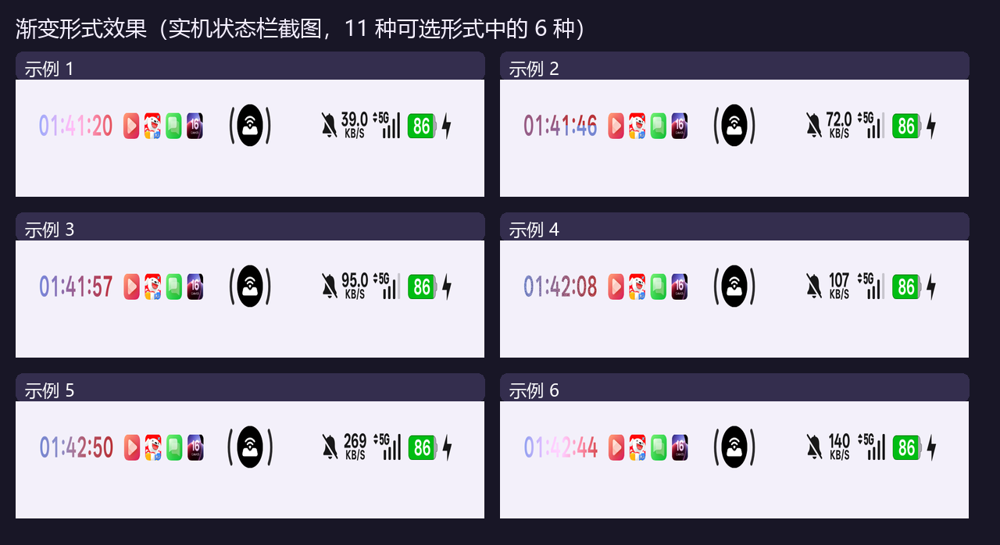

# ClockSeconds v1.2.0 → v1.3.0 更新说明（通俗版）

**一句话**：这次把「高级设置」补齐了——颜色更多、调色更顺手、预设更好管，通知栏大时钟也能显示秒，还修好了几个大家反馈过的小毛病。

## 先看效果

## 这次到底多了什么

### 1. 高级设置页更好用了

- 以前颜色设置散在首页，现在有了独立的「高级设置」页。
- 页面里分成**单色**和**渐变**两个页签，点哪个就切到哪个模式，预览时间也会跟着变。
- 色号框不再单独占一行，而是放到「正在编辑」那一行的右边：**边输边生效**，少滚一屏。

### 2. 预设从「够用」变成「随便存」

- 深色、浅色两组，每组最多 **20 个**自定义预设，互不占用。
- 全新安装会自动带入 **深色 4 套 + 浅色 4 套**（每组 2 渐变 + 2 单色），都是实机调好的颜色。
- 旧用户升级后不会被塞新预设，你原来存的不会被覆盖。
- 长按任意预设可以**删除或重命名**；保存时会真正写进文件，不再出现「提示成功但没存上」。

### 3. 渐变方式多了，效果也更好认

现在一共有 **11 种渐变形式**：

> 上→下、左→右、象限光晕、颗粒噪点、镀铬金属、斜纹糖果、波浪切割、低多边形、水磨石、二维码、液态水银。

- 起点色和终点色各有一个圆圈，点一下会有一圈**多层涟漪**提示当前编辑的是哪一个。
- 方向胶囊改成单行横滑，标题行有一个会动的 **⇆** 箭头提醒「这一排可以左右滑」。
- 渐变也支持**浅色模式单独一套颜色**，系统切到浅色时自动换过去。

### 4. 颜色会跟着系统深浅色走

新增「**系统模式自适应**」：打开后，时间颜色会按系统的深色 / 浅色模式自动切换，不用你手动来回改。旁边有 **?** 图标，点开就能看到说明。

### 5. 自定义任务也能换配色

「自定义任务」里的换配色面板也一起升级：单色方案和渐变方案分开显示，勾选状态不会错位，单色方案显示为**分段纯色条**，不再被误画成渐变。

### 6. 作者信息补上了多语言

「关于」卡片新增作者行，点一下可以跳转到作者主页；这一行已经同步到全部语言。

### 7. 通知栏时间显秒效果

- 下拉通知栏里的大时钟现在也会显示秒（`HH:mm:ss`），不再只有时和分。
- 它和状态栏时间共用同一套逐位颜色 / 渐变设置：在「高级设置」里改颜色，通知栏大时钟会同步跟着变。
- 实机效果见本文第一张图。

### 8. 其他小改进

- 顶部页签改成更紧凑的一体胶囊，不再占掉一大块屏幕。
- 通知栏、浮窗和预览卡的渐变效果保持一致，预览基本就是状态栏实际效果。
- 旧 API 环境装 legacy 包时，会提示还有 API 102 版本可选；modern 包不会重复提示。

## 修好了什么

| 你看到的问题 | 现在 |
|---|---|
| 单色页预览时间突然变得很大，把调色盘挤没了 | 预览卡高度恢复正常 |
| 色号框删空后再也输不进去、也不生效 | 可以正常清空后重新输入 |
| 拖第一条滑杆时，圆圈颜色慢半拍 | 圆圈、预览和状态栏同步变色 |
| HSV 第 2、3 条滑杆不跟着颜色变 | 饱和度 / 明度滑杆会随色相重绘 |
| 预设重命名、删除提示成功但没保存 | 真正写盘，重开还在 |
| 点高级设置闪退 | 已修，不再闪退 |
| 切换深浅色后，高级页和系统颜色对不上 | 以系统模式为准，页面和时间颜色一致 |

## 从 v1.2.0 升级要注意

1. **v1.2.0 正式版用户**：legacy 包可以直接覆盖安装；modern 包是不同包名，覆盖同一包名即可，数据都会保留。
2. **正在用 vc327–vc345 测试包的用户**：测试包和正式版签名不同，**不能直接覆盖**。请先记下预设和任务，卸载测试包后再装正式版。
3. 安装后到 LSPosed 勾选 **com.android.systemui** 作用域，然后重启 SystemUI 或重启手机。
4. 如果升级后发现颜色怪怪的，先检查是不是从测试包直接覆盖安装；签名不同会导致数据读不到。

## 版本信息

- 本版：**v1.3.0**，versionCode **346**。
- modern（API 102）：`io.github.kelebao.colorosclockseconds.modern`，versionName `1.3.0-api102`。
- legacy（API 82）：`io.github.kelebao.colorosclockseconds`，versionName `1.3.0`。
- 安装包：`ClockSeconds-v1.3.0-api102-release.apk`、`ClockSeconds-v1.3.0-legacy-release.apk`。
- 本 Release 同时提供 legacy 与 modern / API 102 两个安装包，按需下载。
- 正式版签名证书未变，SHA-256：`2850e82a5c4e001eb19e1d4d340bfaca049ebea1abc4f1940c02c8065137b82e`。
- GitHub Release / tag / Xposed 仓库：已发布。

## English

**In short**: This release completes the Advanced settings page — more colors, smoother color editing, easier preset management, seconds in the notification-panel clock, and several bug fixes.

### Effects

### What is new

1. **Better Advanced settings** — a dedicated page with separate **Solid** and **Gradient** tabs. Switching tabs switches the mode and the live preview. The hex field now sits on the same row as the color being edited and applies while you type.
2. **Presets you can really manage** — dark and light groups, up to **20** custom presets each. Fresh installs start with 4 dark + 4 light presets; upgrades keep everything you already saved. Long-press a preset to delete or rename it, and changes are actually written to disk.
3. **11 gradient forms** — top→bottom, left→right, quadrant glow, grain, chrome, striped candy, wave cut, low poly, terrazzo, QR code and liquid mercury. The two endpoint circles show a multi-ring ripple when tapped, the direction row scrolls horizontally with a moving **⇆** hint, and gradients can use a separate light-mode palette.
4. **System mode adaptive** — when enabled, clock colors follow the system dark / light mode automatically. The **?** icon next to the switch explains how to use it.
5. **Task recoloring** — the custom-task color picker now separates solid and gradient schemes, keeps checkmarks aligned, and draws solid schemes as segmented color bars instead of gradients.
6. **Author info in every language** — the About card now has an author row that opens the author homepage; it is translated in all 21 locales.
7. **Notification-panel clock with seconds** — the large clock in the notification shade now shows `HH:mm:ss` and shares the same per-digit color / gradient settings as the status-bar clock, so colors stay in sync.
8. **Other refinements** — compact tab header, consistent gradient preview across the notification shade / floating window / preview card, and no duplicate API-102 hints on the modern build.

### Fixes

| Problem you saw | Now |
|---|---|
| Huge preview time on the Solid tab hid the color picker | Preview card is back to normal height |
| Empty hex field could not be filled again or applied | You can clear and retype it normally |
| Endpoint circle lagged behind the first slider | Circle, preview and status bar update together |
| HSV sliders 2 and 3 did not follow the color | Saturation / value sliders redraw with hue |
| Preset rename/delete claimed success but did not save | Changes are really persisted |
| Advanced settings crashed on open | Fixed |
| Advanced page colors disagreed with the system after theme switching | System mode is the single source of truth |

### Upgrading from v1.2.0

1. v1.2.0 users can install the legacy build over the old one. The modern build uses a different package name, so update that same package name to keep data.
2. If you are on test builds vc327–vc345, do **not** install over them — the signing certificate differs. Back up presets and tasks, uninstall the test build, then install the release build.
3. After installing, enable the **com.android.systemui** scope in LSPosed and restart SystemUI or reboot.
4. If colors look wrong after upgrading from a test build, check whether you installed over a differently signed build; data cannot be read in that case.

### Version info

- This release: **v1.3.0**, versionCode **346**.
- modern (API 102): `io.github.kelebao.colorosclockseconds.modern`, versionName `1.3.0-api102`.
- legacy (API 82): `io.github.kelebao.colorosclockseconds`, versionName `1.3.0`.
- Packages: `ClockSeconds-v1.3.0-api102-release.apk`, `ClockSeconds-v1.3.0-legacy-release.apk`.
- Both legacy and modern (API 102) APKs are attached to this release — download the one you need.
- Release certificate is unchanged, SHA-256: `2850e82a5c4e001eb19e1d4d340bfaca049ebea1abc4f1940c02c8065137b82e`.
- GitHub Release / tag / Xposed module repository: published.
