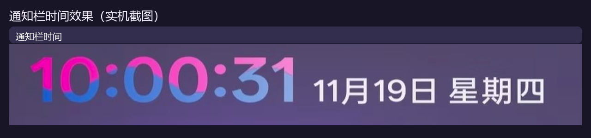
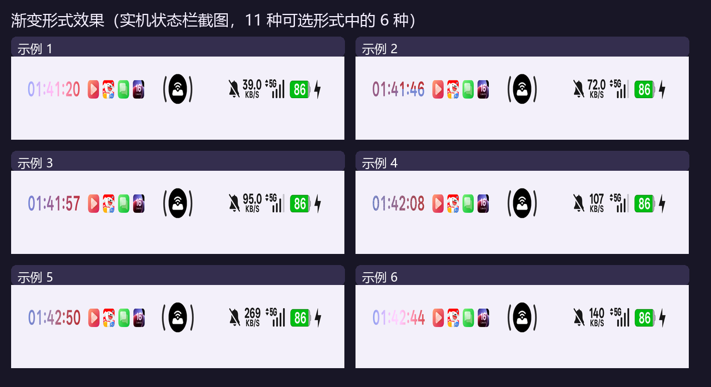

# ClockSeconds v1.3.0 → v1.3.1 更新说明（通俗版）

**一句话**：这是一次「看着更顺眼、用着更省心」的小升级——时间里的冒号会自动摆正，预览时间上的小相机框对准数字了，更新提醒也更稳。

## 先看效果

## 这次到底改了什么

### 1. 冒号会自动摆正

以前有些字体下，状态栏时间里的两个冒号会偏高、偏低或离数字太近。现在改成按**当前字体实际画出来的数字和冒号**来算位置和宽度：

- 状态栏时间：冒号水平宽度和垂直高度都按字形实测，跟着系统字体走。
- 单色预览时间：和状态栏用同一套算法，你看到的预览基本就是真实效果。
- 渐变预览时间：也接上了这套算法，不再出现「数字和冒号不在一条线」的情况。

### 2. 预览时间的小相机框对准了

单色预览里点某一个数字，会有一个四角取景框标出正在编辑的那一位。之前这个框会整体往右偏，点最后一位时甚至框不到数字上。现在：

- 框的位置按文字实际排版算，不再重复叠加边距。
- 四角短线的长度收短了一点，看着更轻巧；框本身的高度恢复正常，不会再被压扁。

### 3. 更新提醒更稳

以前 GitHub API 偶尔限流时，应用内可能收不到更新提醒。现在增加了网页 / Atom 回退：即使 API 暂时不可用，也能继续检查新版本，不会「假装没更新」。

## 修好了什么

| 你看到的问题 | 现在 |
|---|---|
| 冒号忽高忽低、和数字不对齐 | 按当前字体实测字形自动排版，状态栏、单色预览、渐变预览统一 |
| 单色预览的相机框偏到数字右边 | 自动计算字符位置，框准确落在正在编辑的数字上 |
| 相机框四角太长、框太矮 | 四角短线缩短，框高恢复正常 |
| GitHub API 限流后收不到更新提醒 | 增加网页 / Atom 回退，更新检查更可靠 |

## 从 v1.3.0 升级要注意

1. **v1.3.0 正式版用户**：可以直接覆盖安装，预设、任务和设置都会保留。
2. **正在用 vc347–vc353 测试包的用户**：如果签名与正式版一致，可以直接覆盖；若安装器提示签名冲突，请先记下预设和任务，卸载测试包后再装正式版。
3. 安装后到 LSPosed 勾选 **com.android.systemui** 作用域，然后重启 SystemUI 或重启手机。
4. 证书没有更换，SHA-256：`2850e82a5c4e001eb19e1d4d340bfaca049ebea1abc4f1940c02c8065137b82e`。

## 版本信息

- 本版：**v1.3.1**，versionCode **354**。
- modern（API 102）：`io.github.kelebao.colorosclockseconds.modern`，versionName `1.3.1-api102`。
- legacy（API 82）：`io.github.kelebao.colorosclockseconds`，versionName `1.3.1`。
- 安装包：`ClockSeconds-v1.3.1-api102-release.apk`、`ClockSeconds-v1.3.1-legacy-release.apk`。
- 源码 Release / tag：`v1.3.1`；模块仓库 Release tag：`354-1.3.1`。
- 源码 Release：https://github.com/kelebao/ClockSeconds/releases/tag/v1.3.1
- 模块仓库：https://github.com/Xposed-Modules-Repo/io.github.kelebao.colorosclockseconds

## English

**In short**: a polish release — colons are optically aligned from real glyph metrics, the preview viewfinder sits on the digit being edited, and update checks survive GitHub API rate limits.

### What changed

1. **Auto-aligned colons** — colon width and vertical lift are measured from the current font, so the status-bar clock, solid preview and gradient preview all use the same placement.
2. **Preview viewfinder fixed** — the four-corner marker no longer shifts to the right; it lands on the selected digit. The corner arms are shorter and the frame height is back to normal.
3. **More reliable update check** — a web/Atom fallback keeps update notifications working when the GitHub API is rate-limited.

### Upgrading

- v1.3.0 users can install over the old build and keep all settings.
- If you are on a vc347–vc353 test build and the installer reports a signature conflict, back up presets/tasks, uninstall it, then install this release.
- Enable the **com.android.systemui** scope in LSPosed and restart SystemUI or reboot.
- Signing certificate is unchanged: SHA-256 `2850e82a5c4e001eb19e1d4d340bfaca049ebea1abc4f1940c02c8065137b82e`.

### Version info

- This release: **v1.3.1**, versionCode **354**.
- modern (API 102): `io.github.kelebao.colorosclockseconds.modern`, versionName `1.3.1-api102`.
- legacy (API 82): `io.github.kelebao.colorosclockseconds`, versionName `1.3.1`.
- Source tag: `v1.3.1`; module-repo tag: `354-1.3.1`.
